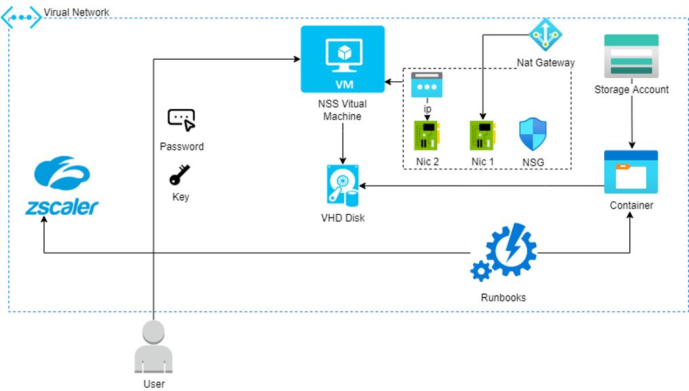

[](https://github.com/willguibr/zscaler-nss-azure-bicep/releases)
[](https://github.com/willguibr/zscaler-nss-azure-bicep/blob/master/LICENSE)
[](https://community.zscaler.com/)

# Zscaler NSS Azure Bicep Deployment

## Overview

This repository contains a [Bicep](https://learn.microsoft.com/azure/azure-resource-manager/bicep/overview) deployment for Zscaler Nanolog Streaming Service (NSS) in Azure. It launches a single NSS virtual machine, but at this time you are required to modify the Network Security Group (NSG) to properly secure inbound connections based on your environment.

The deployment creates:

- 1 x Virtual Machine with a managed OS disk (`<vmName>-osdisk`) imported from the Zscaler NSS VHD
- 2 x Network Interfaces
  - `<vmName>-MGMT-NIC` - NSS Management Interface
  - `<vmName>-SRVC-NIC` - NSS Service Interface, with a static private IP address
- 1 x Public IP Address `<vmName>-MGMT-IP` for the NSS Management Interface
- 1 x Network Security Group `<vmName>-NSG`
- 1 x Storage Account with the container `zscalernssrprod`, used to stage the NSS VHD (new or existing)
- 1 x Deployment Script `<vmName>-vhd-copy` that copies the NSS VHD from Zscaler into the storage account

When a new virtual network is requested, it also creates:

- 1 x Virtual Network with 2 x Subnets
  - Service Subnet (with NAT Gateway)
  - Management Subnet
- 1 x NAT Gateway `<vmName>-NATGW`
- 1 x Public IP Address `<vmName>-SRVC-IP` and 1 x Public IP Prefix `<vmName>-PIP` for the NAT Gateway

When the optional [NSS certificate installation](#optional-install-the-nss-certificate) is requested, it also creates:

- 1 x Deployment Script `<vmName>-nss-certificate` that configures the NSS service interface, registers the VM in ZIA, installs its SSL certificate and enables the automatic start of NSS
- 1 x User-Assigned Managed Identity `<vmName>-certificate-identity` and 1 x Storage Account `nsscert<unique>` that the deployment script runs with
- 1 x Certificate Subnet (with NAT Gateway) in the new virtual network, in which the deployment script runs

### NSS Architecture



> **Note** The diagram predates the Bicep deployment. The "Runbooks" component is now a deployment script, and the VM boots from a managed disk imported from the VHD in the storage account container.

## Important Notes

The NSS OS disk is delivered by Zscaler as a VHD. A deployment script copies that VHD into a storage account in your resource group, and the VHD is then imported as a managed disk that is attached to the VM. After a successful deployment the VM no longer depends on the staged VHD blob. You can delete the blob to save storage cost; if you redeploy later and the blob is missing, it is copied again, which requires a valid SAS token.

The NSS VM carries 2 network interfaces. The primary interface is used for management and carries a public IP address. At this time, you are required to modify the Network Security Group (NSG) to properly secure inbound connections based on your environment. The second interface is used for service purposes, and is placed on a private subnet behind a NAT Gateway.

## Repository Layout

| Path | Purpose |
|------|---------|
| `main.bicep` | Entry point for a deployment into a resource group that already exists. Declares the parameters and outputs and wires the modules together. |
| `main.sub.bicep` | Entry point for a subscription-level deployment. Creates the resource group, or uses an existing one, and then deploys `main.bicep` into it. |
| `modules/` | One Bicep module per concern: network security group, virtual network, storage account, VHD copy, virtual machine, its service network interface and the optional NSS certificate installation. |
| `Makefile` | `make preview`, `make deploy`, `make watch`, `make outputs` and `make destroy` for Linux and macOS. Calls `scripts/deploy.sh`. |
| `scripts/deploy.sh` | Deploys `main.sub.bicep` with one command and reports the progress of the deployment. Started without a resource group, it asks for the values first. It also removes a deployment again. Linux and macOS. |
| `scripts/deploy.ps1` | The same for Windows. |
| `scripts/copy-vhd.ps1` | PowerShell script run by the VHD copy deployment script. It is embedded into the template at build time. |
| `scripts/install-nss-certificate.py` | Python script that configures the NSS service interface, registers the VM in ZIA, installs its certificate and enables the automatic start of NSS. It is embedded into the template at build time and can also be run from a workstation. |
| `scripts/delete-nss-server.py` | Python script that deletes the NSS server object in ZIA. Run by `make destroy` and `deploy.ps1 Destroy` on your computer. |
| `scripts/install-nss-certificate.sh` | Shell script run by the certificate deployment script. It installs the Python packages and starts the Python script. |
| `tests/` | Tests for `install-nss-certificate.py` and `delete-nss-server.py`, which use a local fake of the NSS VM and never contact Zscaler; tests for the two deploy scripts, which use a fake Azure CLI and a fake Zscaler SDK and never contact Azure or Zscaler; and a check that `main.sub.bicep` declares the same parameters and outputs as `main.bicep`. |
| `main.sub.bicepparam` | Parameter file for `main.sub.bicep`: resource group, new virtual network and new storage account. |
| `main.bicepparam` | Parameter file for a new virtual network and a new storage account. |
| `main.existing.bicepparam` | Parameter file for an existing virtual network and an existing storage account. |
| `bicepconfig.json` | Bicep linter configuration. |
| `azuredeploy.json` | ARM template compiled from `main.bicep`. Generated; deploy with the command-line path in this README, not from the Azure Portal. |

## Deployment Instructions

### Prerequisites

Before deploying, ensure you have the following:

1. **Azure Subscription**: An active Azure subscription with permissions to create resources in the target resource group. If you use an existing virtual network in another resource group, you also need permission to join its subnets. A subscription-level deployment (`main.sub.bicep`) also needs permission to create deployments at subscription scope and, when it creates the resource group, to create resource groups, for example through the Contributor role on the subscription.
2. **SAS Token**: Contact [Zscaler Support](https://help.zscaler.com/login-tickets) to obtain the NSS VHD SAS Token for your selected region.
3. **Resource Group**: Decide whether the NSS VM goes into a new or an existing resource group. `make deploy` and `main.sub.bicep` can create the resource group for you. A deployment of `main.bicep` needs a resource group that already exists.
4. **Resource Providers**: `Microsoft.Compute`, `Microsoft.Network`, `Microsoft.Storage`, `Microsoft.Resources` and `Microsoft.ContainerInstance` registered in the subscription. Deployment scripts run in Azure Container Instances.
5. **Tools**: [Azure CLI](https://learn.microsoft.com/cli/azure/install-azure-cli) 2.53.0 or later with the Bicep CLI (`az bicep install`). On Linux and macOS also `make` and `bash`; on Windows, Windows PowerShell 5.1 or PowerShell 7. Azure PowerShell is only needed for the Azure PowerShell commands under [Other Ways to Deploy](#other-ways-to-deploy), together with the [Bicep CLI](https://learn.microsoft.com/azure/azure-resource-manager/bicep/install) on the `PATH`. The Bicep files are validated with Bicep CLI 0.49.2.

The optional [NSS certificate installation](#optional-install-the-nss-certificate) has additional prerequisites, listed in that section.

The storage account that stages the VHD must allow shared key access, because the copy authenticates with the account key. The deployment script also creates a temporary storage account and container instance in the resource group and removes them when the copy succeeds.

### Deploy Step by Step

This is the way to deploy from the command line. One command creates the resource group when it does not exist, deploys everything into it and reports what is being deployed until the deployment ends. On Linux and macOS the command is `make`; on Windows it is `scripts\deploy.ps1`. Both use the Azure CLI.

The shortest way is to let the command ask for everything: after steps 1 to 3, run `make deploy` (Linux and macOS) or `.\scripts\deploy.ps1 Deploy` (Windows) and answer its questions. Step 4 describes them.

To deploy with your own `az` or Azure PowerShell commands instead of `make`, see [Other Ways to Deploy](#other-ways-to-deploy).

#### Step 1: Prepare

1. Install the tools from [Prerequisites](#prerequisites), item 5.
2. Get the SAS token for your VHD region from Zscaler Support. [VHD Image Storage](#zscaler-nss-vhd-image-storage) lists the regions.
3. Decide on the name of the resource group and on the Azure region.

#### Step 2: Get the repository

```bash
git clone https://github.com/willguibr/zscaler-nss-azure-bicep.git
cd nss-azure-deploy
```

All commands below are run from this directory.

#### Step 3: Sign in to Azure

```bash
az login
az account set --subscription "<subscription name or id>"
az account show --query "{name:name, id:id}" --output table
```

The last command shows the subscription the deployment goes to. The deployment is made at subscription level, so your account needs the Contributor role on the subscription, or Owner when the [certificate step](#optional-install-the-nss-certificate) is used. If you only have access to one resource group, use the resource group commands under [Other Ways to Deploy](#other-ways-to-deploy).

#### Step 4: Set your values

There are two ways to give the deployment its values. Use one of them.

**Answer questions.** Start the preview or the deployment without a resource group, and the command asks for the values in the terminal:

```bash
make preview    # or: make deploy
```

```powershell
.\scripts\deploy.ps1 Preview    # or: Deploy
```

```text
RESOURCE_GROUP is not set, so the values of the deployment are asked for here.
Enter keeps the value in [brackets]. Ctrl+C stops. Nothing is deployed before you confirm at the end.

Resource group, used as it is when it exists and created when it does not [Zscaler-NSS-RG]: NSS-RG
  NSS-RG does not exist and will be created.
Azure region for the resource group and everything in it, for example eastus: eastus
Name of the NSS VM [Zscaler-NSS-VM]:
Size of the VM:
   1) Standard_D2_v4   2 vCPUs, 8 GB
   2) Standard_D4_v4   4 vCPUs, 16 GB
   3) Standard_D8_v4   8 vCPUs, 32 GB
   4) Standard_D16_v4  16 vCPUs, 64 GB
Choose 1-4 [1]:
...
```

| Question | Notes |
|----------|-------|
| Resource group | Used as it is when it exists, created when it does not. The region is only asked for a resource group that does not exist. |
| Name and size of the VM | |
| Zscaler storage region | The region your SAS token is for. |
| SSH source | The IP address or CIDR range you administer the VM from, or `*` for every address. The command looks up the public IP address of your computer and offers it; Enter allows SSH from that address only. |
| Virtual network | New or existing. For a new one, the names and address ranges of the parameter file are offered; answer `n` to enter your own. The ranges are checked: every subnet must be inside the virtual network and no two may overlap. For an existing one, its name, its resource group and the names of its two subnets. |
| Storage account | New, or the name of an existing one in the resource group. |
| Certificate step | Whether to register the VM in ZIA, install its certificate and start NSS. With yes: the name and type of the NSS server object, the subnet of the step when the network is not the default one, and which Zscaler API credentials you use. Read [Optional: Install the NSS Certificate](#optional-install-the-nss-certificate) first. |
| Secrets | The SAS token and, with the certificate step, the password of `zsroot` and the API credentials. Only those that are not set in the environment (step 5) are asked for. They are not shown while you type, are used for this run only and are never saved. |

- Enter keeps the value in brackets. Those defaults come from the parameter file. An answer that cannot be used is asked for again, with the reason.
- For the SSH source, the command asks a public service which IP address your computer has on the internet: `https://api.ipify.org`, and `https://checkip.amazonaws.com` when the first does not answer. This is the only request the command makes that does not go to Azure, and it is only made when the question is asked. Check the address before you accept it: behind a proxy, a VPN or Zscaler Internet Access it is the address of that service, which may not be the address your SSH connection comes from and may change. Type another address or range in that case. Set `PUBLIC_IP_URL=none` (`-PublicIpUrl none`) to make no such request, or set it to a service of your own that answers with the address as plain text.
- Every other [parameter](#parameters) keeps the value of the parameter file. Change it there, or pass it with `PARAMETERS` (see [Command reference](#command-reference)). A value passed with `PARAMETERS` or `LOCATION` is not asked for.
- Before anything is deployed, the command shows all values and asks `Deploy now? [y/N]`.
- The answers, without the secrets, are saved in `.nss-deploy-answers` in the repository, a text file with one `name=value` line for each answer that Git ignores. The next `make preview` or `make deploy` shows them and asks `Use these answers again? [Y/n]`, so a preview followed by a deployment, or a deployment that is run again, asks nothing twice. `make watch` and `make outputs` use the resource group of the answers. Delete the file to start over, or set `ANSWERS_FILE` (`-AnswersFile`) to keep a file for each deployment.
- Where there is no terminal, for example in a pipeline, nothing can be asked. The saved answers are used when the file exists; otherwise pass `RESOURCE_GROUP` as shown in steps 6 and 7.
- With `RESOURCE_GROUP` (`-ResourceGroup`) nothing is asked and the saved answers are not used.

**Edit the parameter file.** Open `main.sub.bicepparam` and review these values. [Parameters](#parameters) describes all of them.

| Value | What to set |
|-------|-------------|
| `vhdRegion` | The Zscaler storage region your SAS token is for. |
| `sshSourceAddressPrefix` | The IP address or CIDR range you administer the VM from. The value in the file is a placeholder. |
| `vmName`, `virtualMachineSize` | Name and size of the VM. |
| `virtualNetworkName`, `vNetAddressRange` and the subnet values | The new virtual network. For an existing virtual network set `vNetNewOrExisting` to `'existing'`, add `param virtualNetworkResourceGroup = '<resource group of the network>'` when it is in another resource group, and use the names of your subnets. For an existing storage account set `stgNewOrExisting` to `'existing'` and add `param nameStorageAccount = '<name>'`. |
| `installNssCertificate`, `nssServerName`, `nssServerType` | Set `installNssCertificate` to `true` to have the deployment register the VM in ZIA and install its certificate. Read [Optional: Install the NSS Certificate](#optional-install-the-nss-certificate) first. |

Leave `existingResourceGroupName` and `newResourceGroupName` as they are. The deploy command sets them.

Instead of editing the file you can replace single values on the command line, see [Command reference](#command-reference).

#### Step 5: Provide the secrets

Secrets are not written into any file. The parameter file reads them from environment variables of the terminal you deploy from. When the command asks for the values (step 4), you can skip this step: it asks for every secret that is not set, without showing it.

Linux and macOS:

```bash
export NSS_SAS_TOKEN='<sas-token>'

# Only with installNssCertificate = true:
export NSS_VM_PASSWORD='<password of the zsroot account>'
export ZSCALER_CLIENT_ID='<client-id>'
export ZSCALER_CLIENT_SECRET='<client-secret>'     # or ZSCALER_PRIVATE_KEY
export ZSCALER_VANITY_DOMAIN='<vanity-domain>'
```

Windows PowerShell:

```powershell
$env:NSS_SAS_TOKEN = '<sas-token>'

# Only with installNssCertificate = true:
$env:NSS_VM_PASSWORD = '<password of the zsroot account>'
$env:ZSCALER_CLIENT_ID = '<client-id>'
$env:ZSCALER_CLIENT_SECRET = '<client-secret>'     # or ZSCALER_PRIVATE_KEY
$env:ZSCALER_VANITY_DOMAIN = '<vanity-domain>'
```

The variables for the legacy ZIA API and for another Zscaler cloud are listed under [Deploying with the certificate step](#deploying-with-the-certificate-step).

A variable that is assigned without `export` is not passed on, and the variables are gone when the terminal is closed. To keep a secret out of the shell history, read it instead of typing it into the command: `printf 'SAS token: '; read -rs NSS_SAS_TOKEN; echo; export NSS_SAS_TOKEN`.

#### Step 6: Preview (optional)

The preview lists every resource the deployment would create or change. It changes nothing.

```bash
make preview RESOURCE_GROUP=<resource-group-name> LOCATION=<location>
```

```powershell
.\scripts\deploy.ps1 Preview -ResourceGroup <resource-group-name> -Location <location>
```

Without the resource group, `make preview` and `.\scripts\deploy.ps1 Preview` ask for the values as described in step 4.

#### Step 7: Deploy

Linux and macOS:

```bash
make deploy RESOURCE_GROUP=<resource-group-name> LOCATION=<location>
```

Windows:

```powershell
.\scripts\deploy.ps1 Deploy -ResourceGroup <resource-group-name> -Location <location>
```

Without the resource group, `make deploy` and `.\scripts\deploy.ps1 Deploy` ask for the values as described in step 4, or offer the answers of the preview again.

If Windows refuses to run the script because of the execution policy, run `Set-ExecutionPolicy -Scope Process RemoteSigned` in the same PowerShell window first.

The command:

1. Checks that you are signed in and that the SAS token is set. With `installNssCertificate` set to `true` it also checks that `NSS_VM_PASSWORD` is set, and warns when the Zscaler API variables are incomplete.
2. Looks for the resource group. **If it exists, it is used as it is. If it does not exist, it is created in `LOCATION`.** For an existing resource group `LOCATION` is optional and defaults to the location of the resource group.
3. Shows the subscription, the resource group, the location, the values that were answered and which variables are set, and asks `Deploy now? [y/N]`. No secret is shown.
4. Starts the deployment and reports every step when it starts and when it ends, including the log of the two deployment scripts. For example, shortened:

```text
[10:02:11] The deployment 'nss-NSS-RG' was started.
[10:02:31] resource group NSS-RG: Succeeded
[10:02:31] deployment into resource group NSS-RG: Running
[10:02:52]   step networkSecurityGroup: Running
[10:03:13]     Zscaler-NSS-VM-NSG (networkSecurityGroups): Succeeded
[10:03:13]   step networkSecurityGroup: Succeeded
[10:03:55]   step vhdCopy: Running
[10:04:16]     Zscaler-NSS-VM-vhd-copy (deploymentScripts): Running
[10:05:20]       | Starting the copy of https://znssprod.blob.core.windows.net/nss/znss_5_2_osdisk.vhd to 'zscalernssrprod/znss_Zscaler-NSS-VM_osdisk.vhd'.
[10:09:40]       | VHD copy ⠹ ████████████░░░░░░░░░░░░░░░░░░   42%  210.3 of 500.0 GiB
...
[10:16:20] The deployment succeeded.
```

   The copy of the VHD is the longest step. In a terminal it is shown as one line with a progress bar, the percentage and the amount copied, which is updated in place and stays on the screen when the copy ends. Where a line cannot be updated, for example when the output goes to a file or to the log of a pipeline, the same progress is printed as lines such as `VHD copy: 42% (210.3 of 500.0 GiB)`. Set the `NO_COLOR` environment variable to any value for a bar without colours.

5. Prints the [outputs](#outputs) and ends with status 0, or says what failed and ends with status 1.

The steps are `networkSecurityGroup`, `virtualNetwork` and `storageAccount`, then `vhdCopy`, then `virtualMachine`, and with the certificate step `nssCertificateEnvironment` and `nssCertificate`. Inside `virtualMachine`, the steps `serviceNicWithAzureAddress` and `serviceNic` create the service network interface and then make its address static. Most of the time is spent in `vhdCopy` and in importing the disk. A test deployment in Canada Central with the VHD from `znssprod` took about 15 minutes; expect other regions to differ.

Ctrl+C stops the reporting, not the deployment, which continues in Azure. To follow it again:

```bash
make watch RESOURCE_GROUP=<resource-group-name>
```

```powershell
.\scripts\deploy.ps1 Watch -ResourceGroup <resource-group-name>
```

#### Step 8: Finish the setup

Continue with [After the Deployment](#after-the-deployment).

#### If the deployment fails

The command prints the resource that failed with the message from Azure. Lines marked with `|` are the log of a deployment script.

Correct the cause and run the same command again. Everything that was deployed is kept and reused, and a VHD that was copied completely is not copied again. Frequent causes:

- **`vhdCopy` fails**: the SAS token expired or is for another region than `vhdRegion`.
- **`nssCertificate` fails**: see [If the step fails](#if-the-step-fails). The VM itself is deployed at that point.
- **Azure refuses the deployment before it starts**: the message names the parameter or the permission that is missing.

To start over instead, remove what was deployed with `make destroy` or `.\scripts\deploy.ps1 Destroy`, see [Remove the Deployment](#remove-the-deployment), or delete the resource group and wait until it is gone, which takes several minutes. A deployment stops with a message while the resource group is still being deleted.

#### Command reference

| `make` variable | `deploy.ps1` parameter | Meaning |
|-----------------|------------------------|---------|
| `RESOURCE_GROUP` | `-ResourceGroup` | Resource group of the NSS VM. Used as it is when it exists, created when it does not. Without it, `preview` and `deploy` ask for the values in the terminal, and `watch`, `outputs` and `destroy` use the resource group that was answered. |
| `LOCATION` | `-Location` | Azure region of a new resource group and of the resources. Optional for an existing resource group. |
| `PARAMETER_FILE` | `-ParameterFile` | Parameter file for `main.sub.bicep`. Default: `main.sub.bicepparam`. |
| `PARAMETERS` | `-Parameters` | Values that replace those of the parameter file, as `name=value` pairs separated by spaces. A value cannot contain a space. |
| `DEPLOYMENT_NAME` | `-DeploymentName` | Name of the deployment record in Azure. Default: `nss-<resource group>`. |
| `POLL_SECONDS` | `-PollSeconds` | Seconds between two progress checks. Default: 20. |
| `ASSUME_YES=1` | `-Yes` | Deploy without the confirmation question, for example in a pipeline. |
| `ANSWERS_FILE` | `-AnswersFile` | File the answers to the questions are saved in, without secrets. Default: `.nss-deploy-answers` in the repository. |
| `PUBLIC_IP_URL` | `-PublicIpUrl` | Services that are asked for the public IP address of your computer, which the question about the SSH source offers. Web addresses separated by spaces. Default: `https://api.ipify.org https://checkip.amazonaws.com`. `none` asks no service. |
| `NO_COLOR=1` | `$env:NO_COLOR = '1'` | Progress bar of the VHD copy without colours. |

| Target | `deploy.ps1` action | What it does |
|--------|---------------------|--------------|
| `make preview` | `Preview` | Shows what a deployment would change. Changes nothing. |
| `make deploy` | `Deploy` | Deploys and reports progress until the deployment ends. |
| `make watch` | `Watch` | Reports the progress of a deployment that was started earlier. |
| `make outputs` | `Outputs` | Prints the outputs of the last deployment. |
| `make destroy` | `Destroy` | Deletes what the deployment created, in Azure and in ZIA, after a confirmation. It has its own settings, see [Remove the Deployment](#remove-the-deployment). |

Example with replaced values:

```bash
make deploy RESOURCE_GROUP=NSS-RG LOCATION=eastus \
  PARAMETERS="vhdRegion=znssprod sshSourceAddressPrefix=203.0.113.10/32 installNssCertificate=true"
```

```powershell
.\scripts\deploy.ps1 Deploy -ResourceGroup NSS-RG -Location eastus `
  -Parameters 'vhdRegion=znssprod sshSourceAddressPrefix=203.0.113.10/32 installNssCertificate=true'
```

Do not pass a secret in `PARAMETERS`. Secrets belong in the environment variables of step 5.

### Parameters

| Parameter | Default | Description |
|-----------|---------|-------------|
| `location` | Resource group location | Location for all resources. |
| `vhdRegion` | (required) | Zscaler storage region to copy the NSS VHD from. See [VHD Image Storage](#zscaler-nss-vhd-image-storage). |
| `sasToken` | (required, secure) | SAS token for the NSS VHD in the selected VHD region, with or without the leading `?`. |
| `vNetNewOrExisting` | `new` | `new` creates the virtual network, subnets and NAT Gateway. `existing` uses a virtual network you already have. |
| `stgNewOrExisting` | `new` | `new` creates the storage account that stages the VHD. `existing` uses a storage account you already have. |
| `nameStorageAccount` | (empty) | Name of the existing storage account. It must be in the deployment resource group. Required when `stgNewOrExisting` is `existing`. |
| `virtualNetworkName` | `Zscaler-NSS-VNET` | Name of the new or existing virtual network. |
| `virtualNetworkResourceGroup` | Deployment resource group | Resource group of the existing virtual network. Only used when `vNetNewOrExisting` is `existing`. |
| `vNetAddressRange` | `192.168.100.0/24` | Address range of the new virtual network. |
| `subnetName` | `Zscaler-NSS-Subnet` | Name of the new or existing service subnet. |
| `subnetName2` | `Zscaler-NSS-MGMT-Subnet` | Name of the new or existing management subnet. |
| `subnetAddressRange` | `192.168.100.0/25` | Address range of the new service subnet. |
| `subnetAddressRange2` | `192.168.100.128/28` | Address range of the new management subnet. |
| `vmName` | `Zscaler-NSS-VM` | Name of the virtual machine and prefix for the names of its resources. |
| `virtualMachineSize` | `Standard_D2_v4` | Size of the VM. See [Supported VM Sizes](#supported-vm-sizes). |
| `publicIpSku` | `Standard` | SKU of the public IP addresses, the public IP prefix and the NAT Gateway. `Standard` is the only accepted value. |
| `sshSourceAddressPrefix` | `*` | Source IP address or CIDR range allowed for SSH access. Restrict this to your admin IP range. The default allows any source and is not recommended for production. |
| `installNssCertificate` | `false` | `true` registers the VM in ZIA, installs its SSL certificate and starts NSS after the VM is deployed. See [Optional: Install the NSS Certificate](#optional-install-the-nss-certificate). The parameters below are only used when this is `true`. |
| `nssServerName` | Value of `vmName` | Name of the NSS server object in ZIA. An object with this name is reused; otherwise it is created. |
| `nssServerType` | `NSS_FOR_WEB` | Type of the NSS server object when it is created: `SOFTWARE_AA_FLAG`, `NSS_FOR_WEB`, `NSS_FOR_FIREWALL`, `VZEN`, `VZEN_SME`, `VZEN_SMLB`, `PINNED_NSS`, `MD5_CAPABLE`, `ADP`, `ZIRSVR` or `NSS_FOR_ZPA`. |
| `allowHealthyNssServer` | `false` | `true` installs the certificate even when ZIA reports the existing NSS server object as healthy. |
| `nssVmPassword` | (empty, secure) | Password of the `zsroot` account on the NSS VM. Required when `installNssCertificate` is `true`. |
| `zscalerClientId` | (empty, secure) | OneAPI client ID. |
| `zscalerClientSecret` | (empty, secure) | OneAPI client secret. Leave empty when `zscalerPrivateKey` is used. |
| `zscalerPrivateKey` | (empty, secure) | OneAPI private key in PEM format. Leave empty when `zscalerClientSecret` is used. |
| `zscalerVanityDomain` | (empty) | Zidentity vanity domain for OneAPI. |
| `zscalerCloud` | (empty) | Zscaler cloud for OneAPI. Leave empty for the production cloud. |
| `ziaUsername` | (empty) | Admin user name for the legacy ZIA API. |
| `ziaPassword` | (empty, secure) | Admin password for the legacy ZIA API. |
| `ziaApiKey` | (empty, secure) | API key for the legacy ZIA API. |
| `ziaCloud` | (empty) | ZIA cloud name for the legacy ZIA API, for example `zscalertwo`. |
| `certificateSubnetName` | `Zscaler-NSS-Certificate-Subnet` | Name of the new or existing subnet the certificate deployment script runs in. |
| `certificateSubnetAddressRange` | `192.168.100.144/28` | Address range of the new certificate subnet. |
| `certificateForceUpdateTag` | (empty) | Change this value to run the certificate installation again when no other parameter changed. |

When you use an existing virtual network, both subnets must already exist and the address range parameters are ignored. No NAT Gateway is created in that case, so the service subnet needs its own outbound path.

#### Resource group parameters

`main.sub.bicep` takes every parameter above and two more, which decide the resource group:

| Parameter | Default | Description |
|-----------|---------|-------------|
| `existingResourceGroupName` | (empty) | Name of an existing resource group to deploy into. When it is set, no resource group is created and `newResourceGroupName` is ignored. |
| `newResourceGroupName` | (empty) | Name of the resource group to create. Used when `existingResourceGroupName` is empty. |

- **Existing resource group**: set `existingResourceGroupName`. The resource group is not created and not changed.
- **New resource group**: leave `existingResourceGroupName` empty and set `newResourceGroupName`. The resource group is created in `location`.
- When both are empty, the deployment is refused before anything is created.

In `main.sub.bicep`, `location` defaults to the location of the deployment (`--location`) instead of the location of the resource group. It is the location of a new resource group and of all resources. `virtualNetworkResourceGroup` is empty by default, which means the resource group of the deployment.

These two parameters do not exist in `main.bicep`. There the resource group is chosen with `--resource-group` on the command line.

### Other Ways to Deploy

[Deploy Step by Step](#deploy-step-by-step) is the recommended way from the command line. The plain commands below deploy the same Bicep entry points.

#### Azure CLI, without the scripts

Clone the repository. The parameter files read the SAS token from the `NSS_SAS_TOKEN` environment variable, so the token is never stored in a file.

##### With the resource group handled by the template

`main.sub.bicep` is deployed to the subscription. It creates the resource group or uses an existing one, see [Resource group parameters](#resource-group-parameters), and then deploys everything else into it. Edit `main.sub.bicepparam` with your values, or pass the resource group on the command line as shown here. `--location` is the Azure region of the deployment, of a new resource group and of the resources.

```bash
# Login to Azure
az login

# Provide the SAS token obtained from Zscaler Support
export NSS_SAS_TOKEN='<sas-token>'

# New resource group: preview, then deploy
az deployment sub what-if \
  --location <location> \
  --parameters main.sub.bicepparam \
  --parameters newResourceGroupName=<resource-group-name>

az deployment sub create \
  --location <location> \
  --parameters main.sub.bicepparam \
  --parameters newResourceGroupName=<resource-group-name>

# Existing resource group
az deployment sub create \
  --location <location> \
  --parameters main.sub.bicepparam \
  --parameters existingResourceGroupName=<resource-group-name>
```

An inline `--parameters` value overrides the value in the parameter file. `existingResourceGroupName` wins over `newResourceGroupName` when both are set.

A deployment that created its resource group can be run again with the same `newResourceGroupName` and the same location. For a resource group that this deployment did not create, use `existingResourceGroupName`, so that the deployment does not write to the resource group itself. A resource group cannot change its location, so `newResourceGroupName` with the name of a resource group that exists in another location fails.

> **Note** `what-if` and `validate` do not check that the resource group named in `existingResourceGroupName` exists. With a name that does not exist, the preview succeeds and the deployment itself fails with `ResourceGroupNotFound`.

Azure stores the record of a subscription-level deployment in the location given with `--location`. To deploy again under the same deployment name, use the same location, or give the deployment another name with `--name`.

##### Into a resource group that already exists

`main.bicep` is deployed to a resource group. Edit `main.bicepparam` (new virtual network and storage account) or `main.existing.bicepparam` (existing virtual network and storage account) with your values.

```bash
# Login to Azure
az login

# Create a resource group (if needed)
az group create --name <resource-group-name> --location <location>

# Provide the SAS token obtained from Zscaler Support
export NSS_SAS_TOKEN='<sas-token>'

# Preview the changes
az deployment group what-if \
  --resource-group <resource-group-name> \
  --parameters main.bicepparam

# Deploy
az deployment group create \
  --resource-group <resource-group-name> \
  --parameters main.bicepparam
```

To deploy without a parameter file, pass the values inline:

```bash
az deployment group create \
  --resource-group <resource-group-name> \
  --template-file main.bicep \
  --parameters vhdRegion=znssprod sasToken="$NSS_SAS_TOKEN" sshSourceAddressPrefix=<admin-ip-range>
```

#### Azure PowerShell

Edit `main.bicepparam` or `main.existing.bicepparam` as described under [Azure CLI, without the scripts](#azure-cli-without-the-scripts). To let the template create or select the resource group, deploy `main.sub.bicep` with `New-AzSubscriptionDeployment -Location <location> -TemplateFile main.sub.bicep -TemplateParameterFile main.sub.bicepparam` instead of the commands below, which need an existing resource group.

```powershell
# Login to Azure
Connect-AzAccount

# Create a resource group (if needed)
New-AzResourceGroup -Name <resource-group-name> -Location <location>

# Provide the SAS token obtained from Zscaler Support
$env:NSS_SAS_TOKEN = '<sas-token>'

# Preview the changes
New-AzResourceGroupDeployment `
  -ResourceGroupName <resource-group-name> `
  -TemplateFile main.bicep `
  -TemplateParameterFile main.bicepparam `
  -WhatIf

# Deploy
New-AzResourceGroupDeployment `
  -ResourceGroupName <resource-group-name> `
  -TemplateFile main.bicep `
  -TemplateParameterFile main.bicepparam
```

### Optional: Install the NSS Certificate

After the VM is deployed, its service interface has to be configured, the NSS server has to be added in ZIA and its SSL certificate has to be installed on the VM. With `installNssCertificate` set to `true`, the deployment does this as its last step:

1. Connects to the VM over SSH as `zsroot`, from inside the virtual network, and waits up to 15 minutes for the VM to answer.
2. Runs `sudo nss configure` and answers its questions: the name servers are kept, and the service interface gets the private IP address of `<vmName>-SRVC-NIC` and the gateway of its subnet. See [NSS configuration](#nss-configuration).
3. Looks for an NSS server object named `nssServerName` in ZIA and creates it when it does not exist. An existing object is reused and not changed.
4. Downloads the certificate ZIP file of that NSS server object.
5. Copies it to `/home/zsroot/NssCertificate.zip` on the VM, runs `sudo nss install-cert NssCertificate.zip` and then `sudo nss dump-config`, as described in the [NSS deployment guide](https://help.zscaler.com/zia/nss-deployment-guide-microsoft-azure).
6. Downloads and installs the NSS binaries with `sudo nss update-now`, starts NSS with `sudo nss start` and checks with `sudo nss status` that it runs.
7. Runs `sudo nss enable-autostart`, so NSS starts when the VM starts.

When NSS does not start, the deployment still succeeds, because everything before that is done: the `nssRunning` output is `false`, and the log of the deployment script `<vmName>-nss-certificate` has a line that starts with `WARNING: NSS is not running` and gives the reason. See [After the Deployment](#after-the-deployment) for starting it yourself.

The step is meant for an active NSS VM. It always starts NSS, so do not use it for a VM that is kept as a passive backup.

The step is off by default, and a deployment without it needs no Zscaler credentials.

The step does not activate the ZIA configuration. See [ZIA activation](#zia-activation).

> **Warning** The certificate of an NSS server object must be installed on only one active NSS VM. Use a separate `nssServerName` for every NSS VM. When ZIA reports an existing NSS server object as `HEALTHY`, an NSS VM is already using its certificate, and the step stops unless `allowHealthyNssServer` is `true`.

#### Additional prerequisites

- **Permissions**: The step creates a role assignment, so the account that deploys needs `Microsoft.Authorization/roleAssignments/write` in the resource group, for example through the Owner or the User Access Administrator role. When `main.sub.bicep` creates the resource group, the account needs that permission on the subscription, because it cannot have been granted on a resource group that does not exist yet.
- **Zscaler API credentials**: Either OneAPI (`zscalerClientId`, `zscalerVanityDomain` and `zscalerClientSecret` or `zscalerPrivateKey`) or the legacy ZIA API (`ziaUsername`, `ziaPassword`, `ziaApiKey`, `ziaCloud`). The API client or admin needs permission to manage NSS servers. When both sets are given, OneAPI is used.
- **VM password**: The password of the `zsroot` account, in `nssVmPassword`. A new NSS VM has the default password from the Zscaler NSS documentation. The step does not change it; change it after the deployment.
- **Existing virtual network**: The subnet named in `certificateSubnetName` must already exist, be delegated to `Microsoft.ContainerInstance/containerGroups`, have the `Microsoft.Storage` service endpoint, reach the NSS management subnet on TCP port 22 and have outbound internet access on TCP port 443 to the Zscaler API and to `pypi.org` and `files.pythonhosted.org`. With a new virtual network this subnet is created for you.

#### How it runs

The step is a deployment script that runs in a container inside the virtual network. It therefore reaches the management interface of the VM on its private IP address, and the SSH rule of the network security group (`sshSourceAddressPrefix`) does not have to be opened for it. To run inside the virtual network, the deployment script needs a user-assigned managed identity and a storage account that only accepts traffic from the certificate subnet; both are created by the deployment and are kept afterwards.

The container installs the [Zscaler SDK for Python](https://github.com/zscaler/zscaler-sdk-python) and [Paramiko](https://www.paramiko.org/) from PyPI at pinned versions and uses the SDK for every call to ZIA, including the certificate download (`nss_download_certificate`, which needs SDK release 1.11.5 or later). The password and the API credentials are passed to the container as secure values and are not written to the script log.

The script runs `nss install-cert` over SSH without an interactive login, where the `nss` command is not on the `PATH` of the NSS image. It therefore finds the command first and stops, before it contacts ZIA, when it cannot find it.

The script log is kept with the deployment script resource for one day. It contains the output of `sudo nss install-cert`. Azure shows this log as one long line; every line of the script starts with `==> `, and `make deploy` prints the lines one by one. The output of `sudo nss dump-config` is not written to the log; run the command on the VM to review the configuration.

#### NSS configuration

`sudo nss configure` asks its questions one by one and cannot be given its answers on the command line. The step types the answers the way an administrator would:

| Question of `nss configure` | Answer |
|-----------------------------|--------|
| `nameserver:<address> (Options <c:change, d:delete, n:no change>) [n]`, once for each name server | `n`: the name server is kept. |
| `Do you wish to add a new nameserver? <n:no y:yes> [n]:` | `n` |
| `smnet_dev (Service interface IP address with netmask) []:` | The private IP address of `<vmName>-SRVC-NIC` with the prefix length of the service subnet, for example `192.168.100.4/25`. This is the `serviceInterfaceAddress` output. |
| `smnet_dflt_gw (Service interface default gateway IP address) []:` | The first address of the service subnet, which is the default gateway in an Azure subnet, for example `192.168.100.1`. This is the `serviceInterfaceGateway` output. |

- These are the questions of the NSS 5.2 image for Azure. The step answers only these. When `nss configure` asks anything else, or asks for the address a second time, the step stops, shows what the VM printed and answers nothing further. Nothing has been created in ZIA at that point.
- Afterwards the step compares the values with `sudo nss dump-config`.
- The service network interface keeps its address: the deployment makes the private IP address that Azure assigned to `<vmName>-SRVC-NIC` static.
- Name servers are not added, changed or removed. Use `sudo nss configure` on the VM for that.

When the certificate step is off, run `sudo nss configure` yourself and answer with the `serviceInterfaceAddress` and `serviceInterfaceGateway` outputs.

#### Deploying with the certificate step

Set `installNssCertificate` to `true` in `main.sub.bicepparam`, `main.bicepparam` or `main.existing.bicepparam`. The parameter files read the secrets from environment variables, so they are never stored in a file:

```bash
export NSS_SAS_TOKEN='<sas-token>'
export NSS_VM_PASSWORD='<password of the zsroot account>'

# OneAPI
export ZSCALER_CLIENT_ID='<client-id>'
export ZSCALER_CLIENT_SECRET='<client-secret>'     # or ZSCALER_PRIVATE_KEY
export ZSCALER_VANITY_DOMAIN='<vanity-domain>'
# export ZSCALER_CLOUD='<cloud>'                   # only for a cloud other than production

# or the legacy ZIA API
# export ZIA_USERNAME='<admin-user>'
# export ZIA_PASSWORD='<admin-password>'
# export ZIA_API_KEY='<api-key>'
# export ZIA_CLOUD='<cloud>'

az deployment group create \
  --resource-group <resource-group-name> \
  --parameters main.bicepparam
```

With `make` or `deploy.ps1`, set the same variables and run the deploy command of [Deploy Step by Step](#deploy-step-by-step) instead of the last command. It stops before the deployment starts when `NSS_VM_PASSWORD` is not set.

The step can be added to an NSS VM that this template already deployed: deploy again with the same parameters and `installNssCertificate` set to `true`.

#### Deploying again

The step is safe to repeat:

- The service interface is not configured again when an earlier run of the step configured it with the same values, which the step records in `/home/zsroot/.nss-service-interface-configured`, or when `sudo nss dump-config` already shows them. Other values on the VM are replaced, because only the address of `<vmName>-SRVC-NIC` works in Azure.
- NSS that already runs is neither updated nor started again. NSS that does not run is updated and started.
- `sudo nss enable-autostart` is run every time.
- An NSS server object named `nssServerName` is reused.
- The certificate is not installed again when the VM already has the certificate of that NSS server object. The step records what it installed in `/home/zsroot/.nss-certificate-installed`. A certificate that was regenerated in ZIA is installed again.
- Azure does not run a deployment script again when none of its inputs changed. To run the step again in that case, change `certificateForceUpdateTag`.

#### ZIA activation

A new NSS server object is a pending change in ZIA until the configuration is activated. The step never activates the configuration, and it does not end its Zscaler API session, because ending a session that made a change can activate it. Activate the change yourself in ZIA after the deployment.

#### If the step fails

The VM and its other resources stay deployed. The deployment script `<vmName>-nss-certificate` and its container instance are kept for one day, so you can read the script log in the Azure Portal. Correct the cause and deploy again; an NSS server object that was already created is reused.

#### Running the script from a workstation

`scripts/install-nss-certificate.py` can also be run directly, from a machine that is allowed by `sshSourceAddressPrefix`, for example against a VM that was deployed without the step. It needs Python 3.10 or later:

```bash
python3 -m venv .venv
.venv/bin/pip install 'zscaler-sdk-python>=1.11.5' paramiko

export NSS_VM_HOST='<management public IP address>'
export NSS_VM_PASSWORD='<password of the zsroot account>'
export NSS_SERVER_NAME='<name of the NSS server object>'
# plus the OneAPI or legacy ZIA API variables shown above

.venv/bin/python scripts/install-nss-certificate.py
```

Optional variables: `NSS_SERVER_TYPE` (one of the values of `nssServerType`, default `NSS_FOR_WEB`), `NSS_ALLOW_HEALTHY_SERVER`, `NSS_FORCE_CERTIFICATE_INSTALL` (install even when the same certificate is already installed), `NSS_PRINT_DUMP_CONFIG` (`false` hides the output of `sudo nss dump-config`), `NSS_SERVICE_INTERFACE_ADDRESS` together with `NSS_SERVICE_INTERFACE_GATEWAY` (the `serviceInterfaceAddress` and `serviceInterfaceGateway` outputs; without them `nss configure` is not run), `NSS_START` (`true` runs `sudo nss update-now` and `sudo nss start` when NSS is not running), `NSS_UPDATE_TIMEOUT_SECONDS` (how long `sudo nss update-now` may take, default 600), `NSS_ENABLE_AUTOSTART` (`true` runs `sudo nss enable-autostart`), `NSS_SSH_HOST_KEY_FINGERPRINT` (the `SHA256:...` fingerprint the VM must present), `NSS_VM_PORT`, `NSS_VM_USERNAME`, `NSS_SSH_WAIT_SECONDS` and `NSS_COMMAND_TIMEOUT_SECONDS`.

The script does not verify the SSH host key of the VM unless `NSS_SSH_HOST_KEY_FINGERPRINT` is set; it prints the fingerprint it saw. The deployment script connects inside the virtual network and does not verify it.

### Outputs

| Output | Description |
|--------|-------------|
| `vmResourceId` | Resource ID of the deployed VM. |
| `vmName` | Name of the deployed VM. |
| `osDiskResourceId` | Resource ID of the managed OS disk imported from the NSS VHD. |
| `managementPublicIpName` | Name of the management public IP resource. |
| `managementPublicIpAddress` | Public IP address of the NSS management interface. |
| `managementPrivateIpAddress` | Private IP address of the NSS management interface. |
| `serviceInterfaceAddress` | Static private IP address of the NSS service interface with the prefix length of its subnet, for example `192.168.100.4/25`. The answer to the `smnet_dev` question of `sudo nss configure`. |
| `serviceInterfaceGateway` | Default gateway of the NSS service interface. The answer to the `smnet_dflt_gw` question of `sudo nss configure`. |
| `servicePublicIp` | Public IP address of the NAT Gateway. Empty when an existing virtual network is used. |
| `storageAccountName` | Name of the storage account used to stage the NSS VHD. |
| `virtualNetworkName` | Name of the virtual network. |
| `nssServerId` | ID of the NSS server object in ZIA. Empty when `installNssCertificate` is `false`. |
| `nssRunning` | `true` when the certificate step started NSS or found it running. `false` when NSS did not start, and when `installNssCertificate` is `false`. |

`main.sub.bicep` returns the same outputs and two more:

| Output | Description |
|--------|-------------|
| `resourceGroupName` | Name of the resource group the NSS VM was deployed into. |
| `resourceGroupCreated` | `true` when the deployment was asked to create the resource group, that is, when `existingResourceGroupName` was empty. |

### Supported VM Sizes

The following VM sizes are supported as per [Zscaler's deployment guide](https://help.zscaler.com/zia/nss-deployment-guide-microsoft-azure):

| VM Size | vCPUs | Memory |
|---------|-------|--------|
| `Standard_D2_v4` (default) | 2 | 8 GB |
| `Standard_D4_v4` | 4 | 16 GB |
| `Standard_D8_v4` | 8 | 32 GB |
| `Standard_D16_v4` | 16 | 64 GB |

### After the Deployment

1. **Review the outputs**: The deploy command prints them, and `make outputs RESOURCE_GROUP=<resource-group-name>` prints them again. In the portal they are on the deployment under the resource group's **Deployments**. `managementPublicIpAddress` is the address for SSH.
2. **Activate the change in ZIA**: When the certificate step created the NSS server object, it is a pending change. Activate it in the ZIA Admin Portal. The deployment never does this.
3. **Check the VM**: SSH into the NSS VM as `zsroot` on the management public IP address and run `sudo nss dump-config`. Without the certificate step, run `sudo nss configure` first and answer its two service interface questions with the `serviceInterfaceAddress` and `serviceInterfaceGateway` outputs.
4. **Start NSS**: With the certificate step, NSS is started and `sudo nss enable-autostart` has been run; the `nssRunning` output is `true`. When it is `false`, or without the certificate step, run `sudo nss update-now`, which downloads the NSS binaries, then `sudo nss start`, and check with `sudo nss status`. Without the certificate step, also run `sudo nss enable-autostart`.
5. **Change the password**: A new NSS VM has the default password of the `zsroot` account from the Zscaler NSS documentation. Change it.
6. **Restrict SSH**: Make sure the network security group `<vmName>-NSG` allows inbound SSH only from your admin IP ranges (`sshSourceAddressPrefix`).
7. **Complete the NSS configuration**: Follow [Zscaler's NSS configuration guide](https://help.zscaler.com/zia/about-nanolog-streaming-service). Without the certificate step, this includes adding the NSS server in ZIA and installing its SSL certificate, or deploying again with `installNssCertificate` set to `true`, see [Optional: Install the NSS Certificate](#optional-install-the-nss-certificate).

> **Note** Most of the deployment time is spent copying the VHD image (~500GB+) and importing it as a managed disk. A test deployment in Canada Central with the VHD from `znssprod` took about 15 minutes. Do not cancel the deployment once started.

If the VHD copy fails, the deployment script `<vmName>-vhd-copy` and its container instance are kept for one day so you can read the script log in the Azure Portal.

### Remove the Deployment

`make destroy` (Linux and macOS) and `.\scripts\deploy.ps1 Destroy` (Windows) delete what `make deploy` or `.\scripts\deploy.ps1 Deploy` created: the Azure resources, and the NSS server object in ZIA when the deployment registered the VM there.

```bash
make destroy RESOURCE_GROUP=NSS-RG
```

```powershell
.\scripts\deploy.ps1 Destroy -ResourceGroup NSS-RG
```

Without a resource group, the one of the saved answers is used.

The command finds the deployment through its record in the subscription, `nss-<resource group>`, which `make deploy` and `deploy.ps1` create. A deployment started with plain `az` commands and another name has no such record: delete its resource group and its NSS server object yourself.

It first lists what it deletes and what it keeps, and deletes nothing until you type the name of the resource group. Then it works in this order:

1. **The NSS server object in ZIA.** It is deleted with `delete_nss_server` of `zscaler-sdk-python`, by the ID the deployment recorded (the `nssServerId` output). The object is never looked up by its name, because an object with that name may belong to another NSS VM. When ZIA has another name for that ID than the deployment used (`nssServerName`), nothing is deleted. When the object is already gone, the command continues. When the deletion fails, the command stops and nothing is deleted in Azure.
2. **The Azure resources.** The resource group is deleted with everything in it when the deployment created it and it holds nothing but what the deployment created. In every other case the resource group is kept and only the resources the deployment created are deleted. Resources the deployment used and did not create, such as an existing virtual network or storage account, are never deleted.
3. **The deployment record** in the subscription, last, so that a command that was stopped can be run again and finishes the rest.

A deleted NSS server object is a pending change in ZIA until the configuration is activated. As with the deployment, the command never activates it. Activate it in the ZIA Admin Portal.

What is not deleted:

- A resource group that existed before the deployment, unless you ask for it. After a second `make deploy` into the same resource group, the record no longer shows that the first one created it; the command then asks in a terminal, and keeps the resource group where it cannot ask. `KEEP_RESOURCE_GROUP=0` or `-DeleteResourceGroup` deletes it, and only when it holds nothing but the deployment.
- The container with the copied VHD in a storage account the deployment did not create (`stgNewOrExisting` is `existing`). The summary names it. Delete it yourself; it holds about 500 GB.
- The deployment records inside a resource group that is kept. They hold no resources.
- An NSS server object the deployment did not record: after a deployment without `installNssCertificate`, or one whose certificate step never finished. When such an object exists, give its ID with `NSS_SERVER_ID=<id>` or `-NssServerId <id>`.

Deleting the NSS server object needs:

- **The Zscaler API variables of the deployment** (`ZSCALER_*` or `ZIA_*`, see [Deploying with the certificate step](#deploying-with-the-certificate-step)). In a terminal, what is not set is asked for and not shown. The API client needs permission to delete NSS servers.
- **Python 3.10 or later** on your computer. When it does not have `zscaler-sdk-python`, the command installs the release the deployment uses into a temporary Python environment, which needs access to PyPI, and removes it afterwards.

`KEEP_NSS_SERVER=1` or `-KeepNssServer` leaves the object in ZIA; neither is needed then.

| `make` variable | `deploy.ps1` parameter | Meaning |
|-----------------|------------------------|---------|
| `CONFIRM_DESTROY=<resource group>` | `-ConfirmDestroy <resource group>` | The name of the resource group: destroy without the question, for example in a pipeline. `ASSUME_YES=1` and `-Yes` do not confirm a destroy. |
| `KEEP_NSS_SERVER=1` | `-KeepNssServer` | Leave the NSS server object in ZIA. |
| `KEEP_RESOURCE_GROUP=1` | `-KeepResourceGroup` | Keep the resource group and delete only the resources the deployment created. |
| `KEEP_RESOURCE_GROUP=0` | `-DeleteResourceGroup` | Delete a resource group that existed before the deployment, when it holds nothing but the deployment. |
| `NSS_SERVER_ID=<id>` | `-NssServerId <id>` | Delete the NSS server object with this ID instead of the one the deployment recorded. Its name is not compared. |
| `PYTHON` | `-Python` | The Python that deletes the NSS server object. Default: the first of `python3`, `python` and `python3.14` down to `python3.10` (Windows: `python`, `python3`, `py`) that is Python 3.10 or later. |

Deleting a resource group takes several minutes. Ctrl+C stops the command, not a deletion Azure has started; run the command again to finish.

`scripts/delete-nss-server.py` can also be run by itself, with `NSS_SERVER_ID`, optionally `NSS_SERVER_NAME` (the name the object must have), and the Zscaler API variables.

## Zscaler NSS VHD Image Storage

Zscaler hosts its VHD images in multiple storage accounts across different regions. The `vhdRegion` parameter selects which region the VHD image is transferred from. We recommend that you select the storage closest to the region where the resource group and storage account will be located. The following options are available:

### Commercial Azure Regions

| Region Code | Description |
|-------------|-------------|
| `znssprod` | US Commercial |
| `znssprodeu` | Europe |
| `znssprodau` | Australia |

### Azure Government Regions

The following options must be used specifically by Government customers:

| Region Code | Description |
|-------------|-------------|
| `zsgovnsstexas` | US Gov Texas |
| `zsgovnssarizona` | US Gov Arizona |
| `zsgovnssiowa` | US Gov Iowa |
| `zsgovnssvirginia` | US Gov Virginia |

> **Note** Choosing a government region for deployment in a commercial Azure account is not supported and will cause the deployment to fail.

> **Note** Each region requires authentication via a dedicated SAS Token. Please contact Zscaler Support to obtain the necessary SAS token, by providing the name of the region where you want to download the VHD image from.

## Migrating from the ARM Template

Releases up to v1.0.5 shipped a hand-written ARM template (`azuredeploy.json`), a JSON parameter file and an Automation runbook. The Bicep deployment keeps the same parameter names, resource names and outputs, so existing parameter values carry over. The following changed.

### What you need to change

- **Parameter file**: `azuredeploy.parameters.json` was removed. Move your values into `main.bicepparam` or `main.existing.bicepparam`. If you need a JSON parameter file, a file in the old format still works with the compiled `azuredeploy.json`.
- **`publicIpSku`**: `Basic` is no longer accepted. Azure retired Basic SKU public IPs on September 30, 2025, and NAT Gateway never supported them. Remove the parameter or set it to `Standard`.
- **`sasToken`**: Now required. The ARM template defaulted to an empty token and failed later, during the VHD copy.
- **`nameStorageAccount`**: The placeholder default `existingstg` was replaced with an empty default. Set it whenever `stgNewOrExisting` is `existing`.

### What behaves differently

- **Managed OS disk**: The VM boots from a managed disk (Standard HDD, 600 GB) imported from the staged VHD, instead of attaching the VHD blob as an unmanaged disk. Azure [retired unmanaged disks](https://learn.microsoft.com/azure/virtual-machines/unmanaged-disks-deprecation) on March 31, 2026, so VMs that use them can no longer be started.
- **VHD copy**: A deployment script replaces the Automation account, credential, runbook, PowerShell modules and job. The SAS token and the storage account key are passed to the script as secure values instead of job parameters. A failed copy now fails the deployment at that step.
- **Management public IP**: `<vmName>-MGMT-IP` is a Standard SKU address with static allocation instead of a Basic SKU address with dynamic allocation. Its address is available as the new `managementPublicIpAddress` output.
- **Service interface address**: `<vmName>-SRVC-NIC` keeps the private IP address Azure assigned to it as a static address, because that address is written into the NSS configuration. It is available, with the gateway, as the new `serviceInterfaceAddress` and `serviceInterfaceGateway` outputs.
- **Existing virtual network**: `<vmName>-SRVC-IP` and `<vmName>-PIP` are created only together with the NAT Gateway, that is, only when `vNetNewOrExisting` is `new`. The ARM template created them unattached. The `servicePublicIp` output is empty in this case.
- **New storage account**: Created with public blob access disabled, HTTPS only and a minimum TLS version of 1.2. Existing storage accounts are not modified.
- **Staged VHD**: An already completed copy of the VHD in the storage account is reused instead of being copied again.

### Existing NSS VMs

Do not deploy the Bicep version over a VM that was created by the ARM template with the same `vmName`. That VM uses an unmanaged OS disk, and the OS disk of an existing VM cannot be switched to a managed disk by a deployment. Deploy a new NSS VM with a different `vmName` or into a different resource group, or follow Microsoft's guidance to [migrate the existing VM to managed disks](https://learn.microsoft.com/azure/virtual-machines/unmanaged-disks-deprecation).

The `VHDcopy-Automation-<unique>` Automation account created by the ARM template is not used by the Bicep deployment. It stores the storage account key as a credential, so delete it once you no longer need it.

The ARM templates of earlier releases download `scripts/copyvhd.ps1` from the `master` branch. That file was removed, so those templates can no longer be deployed.

## Development

The Bicep files are the source of truth. After changing any of them, build, lint and regenerate the compiled template:

```bash
az bicep build --file main.bicep --outfile azuredeploy.json
az bicep lint --file main.bicep
az bicep lint --file main.sub.bicep
NSS_SAS_TOKEN=placeholder az bicep lint --file main.sub.bicepparam
NSS_SAS_TOKEN=placeholder az bicep lint --file main.bicepparam
NSS_SAS_TOKEN=placeholder az bicep lint --file main.existing.bicepparam
```

`main.sub.bicep` declares the parameters and outputs of `main.bicep` a second time. Change both files together; the tests fail when they differ. `scripts/deploy.sh` and `scripts/deploy.ps1` do the same thing for two platforms; change them together as well.

After changing `scripts/install-nss-certificate.py`, `scripts/delete-nss-server.py`, a deploy script, the `Makefile`, `main.bicep` or `main.sub.bicep`, also run the tests. They need `pytest` and `paramiko`. The tests that go through the Zscaler SDK also need `zscaler-sdk-python` 1.11.5 or later and `responses`; the tests of the deploy scripts need `jmespath`, `bash` and, for `deploy.ps1`, PowerShell 7. Tests whose requirements are missing are skipped:

```bash
python3 -m pytest tests
```

See [CLAUDE.md](CLAUDE.md) for the conventions used in the Bicep code.

## Support and Reporting Issues

Support for this deployment is made available exclusively through Github repo issue tracking.  You are also welcome to contact the contributors directly via their provided contact information.  If you find a bug, please open an issue against this repo [here](https://github.com/willguibr/zscaler-nss-azure-bicep/issues).

## Contributors

Zscaler is actively contributing to and maintaining this repo.

  Contributors:
  [Eddie Parra](https://github.com/eparra), [Rohan Upalekar](https://github.com/rohan-zscaler), Anoop SV, [William Guilherme](https://github.com/willguibr), [Paul Lopez](https://github.com/prlopez)

## Licensing

This work is released under the MIT license. A copy of the license is provided in the [LICENSE](https://github.com/willguibr/zscaler-nss-azure-bicep/blob/master/LICENSE) file.

## References

- [About Nanolog Streaming Service](https://help.zscaler.com/zia/about-nanolog-streaming-service)

`Tags: virtual machine, Linux, Ubuntu Server, Bicep, Microsoft.Network/networkInterfaces, Microsoft.Network/networkSecurityGroups, Microsoft.Network/virtualNetworks, Microsoft.Network/virtualNetworks/subnets, Microsoft.Network/publicIPAddresses, Microsoft.Network/natGateways, Microsoft.Compute/virtualMachines, Microsoft.Compute/disks, Microsoft.Storage/storageAccounts, Microsoft.Resources/deploymentScripts, Microsoft.ManagedIdentity/userAssignedIdentities, Microsoft.Authorization/roleAssignments`
# zscaler-nss-azure-bicep
